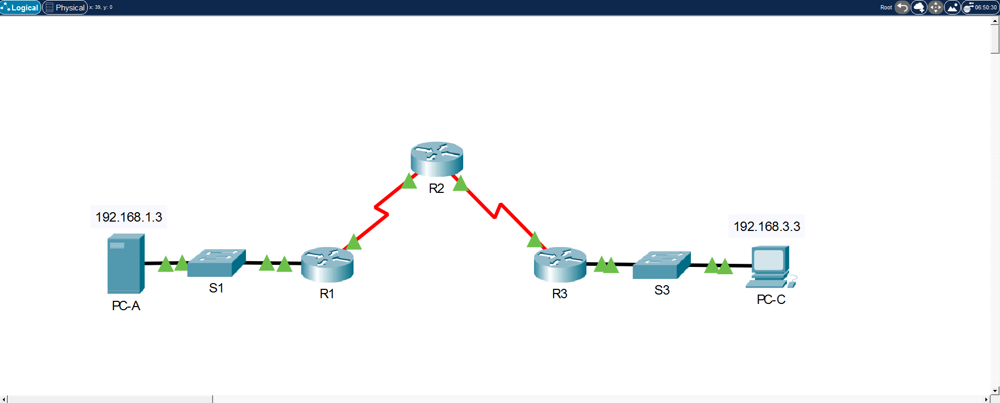
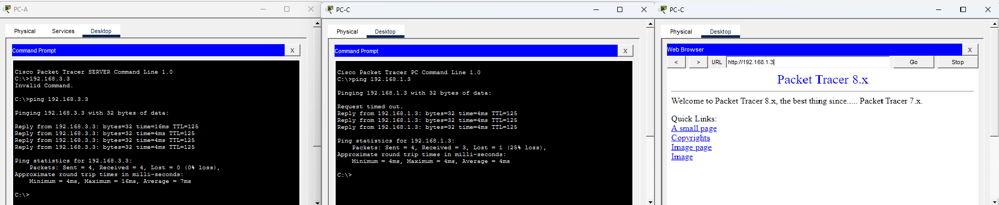
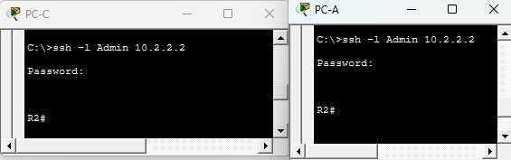
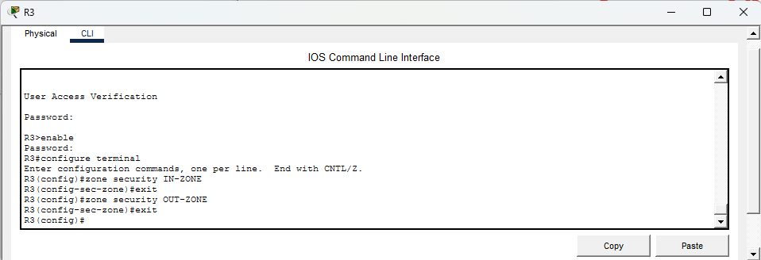
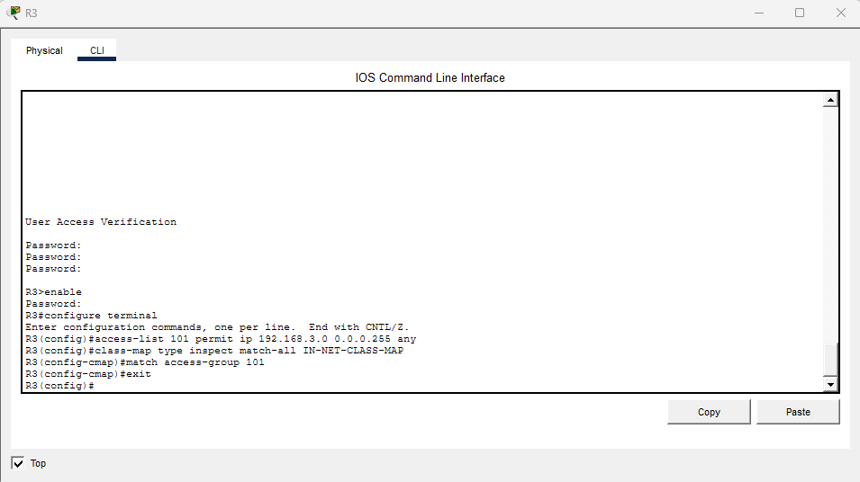
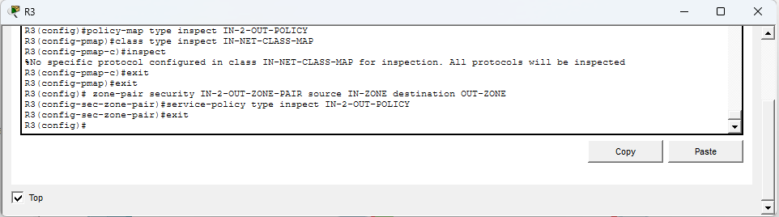
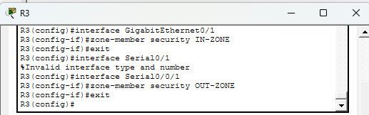
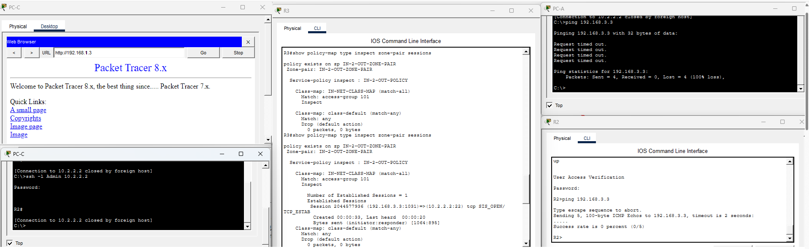

# Implementación de Zone-Based Policy Firewall (ZPF) en Cisco IOS

## Descripción General
Este proyecto documenta la implementación de un **Zone-Based Policy Firewall (ZPF)** en el router de borde **R3** utilizando Cisco Packet Tracer. El objetivo principal es establecer un perímetro de seguridad inspeccionado por estado (*stateful inspection*) que permita a los hosts de la red interna privada acceder de forma segura a servicios en la red externa (HTTP, SSH, ICMP), bloqueando simultáneamente todo intento de conexión no solicitada iniciado desde la red externa hacia la infraestructura privada.

Esta configuración simula un escenario real de endurecimiento de perímetro (*perimeter hardening*) esencial para funciones de análisis SOC Nivel 1, administración de red e ingeniería de ciberseguridad.

---

## Objetivos del Laboratorio
* Establecer la línea base de conectividad de red antes de aplicar políticas de filtrado (*Baseline Testing*).
* Configurar zonas de seguridad lógicas (`IN-ZONE` y `OUT-ZONE`) en el router de borde R3.
* Clasificar el tráfico de la red privada mediante **Access Control Lists (ACL)** y **Class Maps**.
* Diseñar políticas de inspección de estado con **Policy Maps** y vincularlas a un **Zone Pair** direccional.
* Asignar interfaces físicas a sus respectivas zonas de seguridad para activar la política.
* Validar la seguridad del firewall mediante pruebas de penetración no solicitadas y auditoría de la tabla de estado (*State Table*).

---

## Tecnologías Utilizadas
* **Plataforma de Simulación:** Cisco Packet Tracer.
* **Sistema Operativo:** Cisco IOS Software.
* **Conceptos de Ciberseguridad:** Zone-Based Policy Firewall (ZPF), Stateful Packet Inspection (SPI), Permiso Implícito por Zona, Denegación Implícita (*Implicit Deny*).
* **Protocolos e Interfaces:** TCP, UDP, ICMP, HTTP (Puerto 80), SSH (Puerto 22), Access Control Lists (ACL 101 estándar/extendida).

---

## Topología de Red

### Tabla de Direccionamiento IP

| Dispositivo | Interfaz | Dirección IP | Máscara de Subred | Puerta de Enlace Predeterminada | Zona ZPF |
| :--- | :--- | :--- | :--- | :--- | :--- |
| **R1** | G0/1 | 192.168.1.1 | 255.255.255.0 | N/A | Externa |
| **R1** | S0/0/0 | 10.1.1.1 | 255.255.255.252 | N/A | Externa |
| **R2** | S0/0/0 | 10.1.1.2 | 255.255.255.252 | N/A | Externa |
| **R2** | S0/0/1 | 10.2.2.2 | 255.255.255.252 | N/A | Externa |
| **R3** | G0/1 | 192.168.3.1 | 255.255.255.0 | N/A | **IN-ZONE** |
| **R3** | S0/0/1 | 10.2.2.1 | 255.255.255.252 | N/A | **OUT-ZONE** |
| **PC-A** | NIC | 192.168.1.3 | 255.255.255.0 | 192.168.1.1 | Externa |
| **PC-C** | NIC | 192.168.3.3 | 255.255.255.0 | 192.168.3.1 | Interna |

---

## Fase 1: Verificación de Conectividad Inicial (Línea Base)

Antes de aplicar la política de firewall, se verificó el enrutamiento completo de extremo a extremo entre los hosts y routers para asegurar que la red funcionara correctamente.

1. **Prueba ICMP y HTTP:** Se realizaron pings exitosos y navegación web HTTP desde **PC-C** (`192.168.3.3`) hacia **PC-A** (`192.168.1.3`).
2. **Prueba de Control:** Se confirmó que **PC-A** podía alcanzar la red interna sin restricciones.

3. **Prueba SSH a R2:** Se confirmó conectividad SSH exitosa desde ambas PCs hacia la interfaz `10.2.2.2` de **R2**.

---

## Fase 2: Configuración del Zone-Based Policy Firewall (ZPF)

La configuración se realizó en el router **R3** siguiendo la metodología de arquitectura CMM (Class-Based Policy Language).

### Paso 1: Creación de Zonas de Seguridad
Se definieron las zonas de confianza para delimitar el perímetro.

R3(config)# zone security IN-ZONE
R3(config-sec-zone)# exit
R3(config)# zone security OUT-ZONE
R3(config-sec-zone)# exit

* **Propósito:** Agrupar interfaces por niveles de seguridad. Todo el tráfico entre diferentes zonas queda denegado por defecto hasta definir una política explícita.

---

### Paso 2: Clasificación del Tráfico (ACL y Class Map)
Se configuró una ACL para identificar todo el tráfico originado en la red LAN privada y se acopló a un mapa de clases de tipo inspección.

R3(config)# access-list 101 permit ip 192.168.3.0 0.0.0.255 any
R3(config)# class-map type inspect match-all IN-NET-CLASS-MAP
R3(config-cmap)# match access-group 101
R3(config-cmap)# exit

* **Propósito:** El `class-map type inspect` permite al motor del firewall seleccionar los paquetes específicos que serán monitoreados por la tabla de estado.

---

### Paso 3: Definición de Política y Par de Zonas (Policy Map & Zone Pair)
Se asignó la acción `inspect` a la clase definida y se creó la relación direccional desde `IN-ZONE` hacia `OUT-ZONE`.

R3(config)# policy-map type inspect IN-2-OUT-POLICY
R3(config-pmap)# class type inspect IN-NET-CLASS-MAP
R3(config-pmap-c)# inspect
R3(config-pmap-c)# exit
R3(config-pmap)# exit

R3(config)# zone-pair security IN-2-OUT-ZONE-PAIR 
            source IN-ZONE destination OUT-ZONE
R3(config-sec-zone-pair)# service-policy type inspect 
                          IN-2-OUT-POLICY
R3(config-sec-zone-pair)# exit

* **Propósito:** La acción `inspect` activa la inspección de estado (*Stateful Firewall*). Cuando un paquete sale de la LAN, el firewall registra la IP/puerto de origen y destino en la *State Table*, abriendo un puerto temporal para permitir **únicamente la respuesta legítima de retorno**.

---

### Paso 4: Asignación de Interfaces Físicas a las Zonas
Se vincularon las interfaces físicas del router R3 a sus contenedores lógicos correspondientes para aplicar la política.

R3(config)# interface GigabitEthernet0/1
R3(config-if)# zone-member security IN-ZONE
R3(config-if)# exit

R3(config)# interface Serial0/0/1
R3(config-if)# zone-member security OUT-ZONE
R3(config-if)# exit

---

## Fase 3: Verificación de Seguridad y Auditoría SOC

Para confirmar la eficacia del firewall, se ejecutaron pruebas cruzadas de tráfico saliente e ingresante, auditando las sesiones en tiempo real desde R3.

### Resultados de la Auditoría

| Origen | Destino | Protocolo / Servicio | Estado del Tráfico | Explicación Técnica (SOC Perspective) |
| :--- | :--- | :--- | :--- | :--- |
| **PC-C (Interna)** | R2 (`10.2.2.2`) | SSH (22) | **PERMITIDO** | Tráfico saliente legítimo originado en `IN-ZONE`. El firewall registra la sesión en la tabla de estado. |
| **PC-C (Interna)** | PC-A (`192.168.1.3`) | HTTP (80) | **PERMITIDO** | Tráfico de navegación saliente inspeccionado correctamente. La respuesta web de PC-A reingresa por coincidencia de estado. |
| **PC-A (Externa)** | PC-C (`192.168.3.3`) | ICMP (Ping) | **BLOQUEADO** | Tráfico no solicitado desde `OUT-ZONE`. Al no existir una entrada previa en la tabla de estado, aplica *Implicit Deny*. |
| **R2 (Externa)** | PC-C (`192.168.3.3`) | ICMP (Ping) | **BLOQUEADO** | El router R2 intenta iniciar una conexión directa a la LAN interna. Es rechazado por falta de regla de entrada. |

### Comando de Verificación de Sesiones en R3:
R3# show policy-map type inspect zone-pair sessions

**Salida de la auditoría:**
policy exists on zp IN-2-OUT-ZONE-PAIR
Zone-pair: IN-2-OUT-ZONE-PAIR
  Service-policy inspect : IN-2-OUT-POLICY
    Class-map: IN-NET-CLASS-MAP (match-all)
      Match: access-group 101
      Inspect
        Number of Established Sessions = 1
        Established Sessions
          Session 2044577936 (192.168.3.3:1031)=>(10.2.2.2:22) tcp SIS_OPEN/TCP_ESTAB

---

## Conceptos Aprendidos & Relevancia SOC Nivel 1
* **Diferencia entre ACL Tradicional y ZPF:** Mientras que las ACLs estáticas operan filtrando paquetes de forma independiente sin recordar el contexto (Stateless), ZPF evalúa el contexto de la sesión completa de Capa 4 a Capa 7 (Stateful).
* **Defensa en Profundidad:** ZPF simplifica la administración de seguridad en redes complejas reduciendo la probabilidad de brechas causadas por malas configuraciones de ACLs.
* **Monitoreo e Investigación de Sesiones:** Capacidad para auditar las tablas de conexiones vivas (`SIS_OPEN`, `TCP_ESTAB`) para identificar posibles balizamientos (*beaconing*) o conexiones sospechosas iniciadas desde hosts comprometidos dentro de la red.

---

## Posibles Mejoras para Entornos de Producción
1. **Configuración de Zona DMZ:** Agregar una zona `DMZ-ZONE` para alojar servidores web/correo accesibles públicamente con políticas segregadas tanto de la LAN como de Internet.
2. **Registro y Logging (Syslog):** Activar `parameter-map type inspect` para enviar logs detallados de conexiones denegadas (*Audit Trail*) a un SIEM como Splunk o Cisco Chronicle.
3. **Control de Aplicaciones NBAR2:** Implementar inspección de capa 7 para filtrar el tráfico por tipo de aplicación y no solo por número de puerto TCP/UDP.

---

## Conclusión
La implementación exitosa del Zone-Based Policy Firewall en el router R3 garantiza la confidencialidad e integridad de la red privada interna. Mediante el uso de inspección de estado, la LAN puede operar normalmente hacia servicios externos mientras permanece invisible e inalcanzable ante intentos de intrusión iniciados desde redes públicas no confiables.
